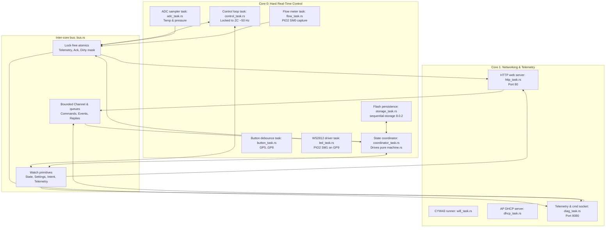

# Firmware design and architecture

## 1. Platform

| Item | Value |
| --- | --- |
| Microcontroller | RP2350B (Pimoroni Pico Plus 2 W) |
| Runtime | Rust `no_std`, Embassy async framework |
| Allocation | No dynamic heap; static cells and `heapless` only |
| Shared Protocol | `oximite-proto` crate (`proto/`) |
| Target | `thumbv8m.main-none-eabihf` (configured in `firmware/.cargo/config.toml`) |

## 2. Core allocation

### Pure logic modules

The following pure `no_std` modules contain no `embassy-*`, `defmt`, hardware, or clock dependencies and are verified on the host in `host-tests/`:
`board.rs`, `sensors.rs`, `flow.rs`, `pid.rs`, `controller.rs`, `machine.rs`, `debounce.rs`, `leds.rs`, `backoff.rs`, `dhcp_codec.rs`, and `http_codec.rs`.

### Core 0 responsibilities

- **Control loop task (`control_task.rs` + `controller.rs` + `pid.rs`):** PIO0 SM1 times the LOW window starting at the zero-cross falling edge and wakes the task on the next rising edge. Drains the FIFO, updates `ControlEngine`, and drives the pump triac and heater SMs.
- **ADC sampler task (`adc_task.rs` + `sensors.rs`):** Samples boiler temperature and grouphead pressure using oversampling and thermistor LUT interpolation.
- **Flow meter task (`flow_task.rs` + `flow.rs`):** Captures flow turbine half-periods on PIO2 SM0 and computes instantaneous flow rate and cumulative shot volume. The turbine constant is configured in `DEFAULT_SETTINGS`.
- **State coordinator (`coordinator_task.rs` + `machine.rs`):** Manages `MachineState` transitions, steps through extraction profiles, controls the solenoid valve, and manages deferred settings writes. Wire values: `0=Idle`, `1=Brewing`, `2=Steaming`, `3=Sleeping`, `4=Pumping`, `5=Cooling`, `6=HotWater`.
- **Button debouncer (`button_task.rs` + `debounce.rs`):** Debounces GP5..GP8 switches (5 consecutive 10 ms samples).
- **LED status task (`led_task.rs` + `leds.rs`):** Computes status RGB values and shifts WS2812 words at 10 Hz via PIO2 SM1.
- **Flash persistence (`storage_task.rs`):** Sole owner of internal flash reads and writes via `DMA_CH1`.

### Core 1 responsibilities

- **CYW43 runner (`wifi_task.rs` + `backoff.rs`):** Runs the Wi-Fi chip over PIO1 SM0 SPI, seeds `embassy-net` from OTP chip ID XOR `RoscRng`, monitors both link and DHCP config loss, runs a self-arming ICMP gateway probe to detect silent AP restarts, enforces `leave()` before retries, and tears down active Port 80/8080 sockets on network drop.
- **AP DHCP server (`dhcp_task.rs` + `dhcp_codec.rs`):** Allocates IPv4 leases to clients in Access Point mode.
- **HTTP server (`http_task.rs` + `http_codec.rs`):** Serves the offline web dashboard and REST endpoints on port 80.
- **Telemetry socket (`diag_task.rs`):** Streams length-prefixed Postcard v3 `DeviceMsg` frames at 50 Hz and executes newline-delimited JSON commands on port 8080.

## 3. Dual-PID control loop architecture

Core 0 evaluates two independent PID controllers (`pid.rs`) inside `ControlEngine` (`controller.rs`):

### 3.1 Temperature PID (`temp_pid`)

- **Execution rate:** 5 Hz (every 10 mains half-cycles).
- **Output:** Delta-sigma SSR duty modulation (0.0 to 100.0%).
- **Dynamic flow feed-forward:** During active brewing (`brew_active = true`), `ControlEngine` raises the temperature setpoint in proportion to incoming cold-water flow (`flow_ml_s`) and `feed_forward_percents`, clamped to a +20.0 °C maximum offset (`controller.rs`).

### 3.2 Unified Pressure and Flow PID (`pump_pid`)

- **Execution rate:** 50 Hz (every AC mains half-cycle).
- **Output:** Phase-angle firing delay for the vibration pump triac.
- **Two-dimensional target normalization:** Profile steps define both target pressure $P_{\text{target}}$ (bar) and target flow rate $Q_{\text{target}}$ (ml/s). Both map onto a unified normalized axis centered at `1.0` (`W_PRESSURE = 4.0`, `W_FLOW = 1.0`):
  $$u_p = 1.0 + W_p \times \left(\frac{P_{\text{meas}}}{P_{\text{target}}} - 1.0\right)$$
  $$u_q = 1.0 + W_q \times \left(\frac{Q_{\text{meas}}}{Q_{\text{target}}} - 1.0\right)$$
- **Binding constraint arbitration:** `pump_pid` targets `1.0` against $\max(u_p, u_q)$. When flow exceeds target (such as puck channeling), $u_q \ge u_p$ limits pump power and sets `flow_controlled`. Once puck resistance builds, $u_p$ dominates.

## 4. AC actuator and PIO timing

The vibration pump incorporates an internal diode, energizing on only one half-wave of AC mains (50 Hz or 60 Hz). The control loop locks directly to this frequency.

The zero-cross optocoupler pulls GP10 LOW during the positive half-wave and releases HIGH during the negative half-wave. The falling edge provides the sole timing reference.

### State machine allocation (PIO0)

| SM | Clock | Counts | Role |
| --- | --- | --- | --- |
| Trigger (SM1) | 2 MHz | 1 µs per count | Measures the LOW conduction window and paces the control tick. |
| Triac (SM2) | 1 MHz | 1 µs per count | Fires the pump triac gate after a phase delay from the falling edge. |
| Heater (SM0) | 16 kHz | 2 ms settle | Latches the boiler heater bit clear of the zero crossing. |

### Firing delay and fail-safe logic

- **Triac delay calculation:** Expressed as a fraction of the measured zero-cross EMA (`delay_fraction` in `controller.rs`):
  $$\text{delay} = \text{fraction}(\text{duty}) \times \text{ac\_ema}$$
  `POWER_TO_DELAY_LUT` scales from `0.80` at 0% duty down to `0.20` at 100% duty.
- **Heater hardware fail-safe:** The Heater SM uses `pull noblock`. An empty TX FIFO reads `0` (heater OFF). If the control task stalls, hardware turns the heater off cleanly.

### Cycle execution timeline

| t (ms) | ZC | Half-wave | Trigger SM (PIO) | Control task | Pump triac (random-phase MOC) | Heater (zero-cross MOC) |
| ---:|:---:|:--- |:--- |:--- |:--- |:--- |
| 0 | ↑ | HIGH | Rising edge: push count; re-arm | Woken: drain FIFO, compute $D_1, H_1$, push FIFOs | SM parked holding $D_1$ | — |
| 10 | ↓ | **LOW** | Falling edge: count 1 µs/tick | Idle | Edge seen: delay $d(D_1)$, gate at $10 + d_1$ | `wait 0` → `nop [31]` |
| 20 | ↑ | HIGH | Push word 2 | Wake: compute $D_2, H_2$ | Triac commutates off at current zero | $H_1$ latched at 12 ms; MOC on for full cycle |
| 30 | ↓ | **LOW** | Count | Idle | Gate at $30 + d_2$ | $H_2$ latched at 32 ms |
| 40 | ↑ | HIGH | Push word 3 | Wake: compute $D_3, H_3$ | Off | $H_2$ conducts |
| 50 | ↓ | **LOW** | Count | Idle | Gate at $50 + d_3$ | $H_3$ latched at 52 ms |

## 5. Non-volatile flash storage

Oximite persists settings and extraction profiles in `FS_RANGE` (`board.rs`), a single 64 KiB wear-leveled `sequential-storage 8.0.2` `MapStorage<u8>` partition at the end of the 16 MiB flash.

| Key | Section | Content |
| --- | --- | --- |
| `1` | Machine | `MachineSettings` JSON |
| `2` | Temp PID | `PidSettings` JSON for boiler |
| `3` | Pump PID | `PidSettings` JSON for pump |
| `4` | Wi-Fi | `WifiSettings` JSON (`ssid`, `password`) |
| `10..=19` | Profiles | Up to 10 `BrewProfile` JSON objects (limit: REQ-16) |

### Storage ownership and mid-shot deferral

- Core 0 alone reads and writes flash via `DMA_CH1` (`storage_task.rs`). Core 1 never touches flash hardware.
- Persistent configuration commands (`Ambient::RamAndFlash`: `save_machine`, `save_pids`, `save_wifi`, `save_profile`, `delete_profile`) received while `state.is_busy()` is true defer **both RAM activation and flash commit** in `DeferredWrites` (`machine.rs`). Distinct sections coalesce per section without dropping updates to other sections.
- Once the machine returns to an idle state (`!state.is_busy()`), `machine.rs` applies deferred writes to RAM, sets section bits in `bus::FLASH_DIRTY`, and wakes `storage_task` to flush updated keys and emit `DeviceEvent::FlashSaved`.
- Session brew temperature updates (`set_session_temp`, `Ambient::RamOnly`) apply to RAM immediately without touching flash.

## 6. Inter-core communication

All cross-core communication is centralized in `bus.rs`:

- **Lock-free atomics:** Latest sensor readings, flow volume, `MachineState` mirror, session brew temp, command `ack`, and coalesced `FLASH_DIRTY` mask use `portable_atomic` registers so Core 1 reads without stalling Core 0.
- **Watch channels:** `MACHINE_STATE`, `TELEMETRY_WATCH`, `SETTINGS_WATCH`, and `CONTROL_INTENT` distribute coherent state snapshots.
- **Bounded channels & event queue:** Inbound commands from HTTP and Port 8080 enter `CMD_QUEUE`; Port 8080 replies and `DeviceEvent` notifications use bounded queues drained by `diag_task.rs`.
- **DMA IRQ sharing:** `DMA_CH0` (CYW43 SPI on Core 1) and `DMA_CH1` (Flash on Core 0) share `DMA_IRQ_0`, masked on Core 0 and serviced on Core 1 (`main.rs`).
