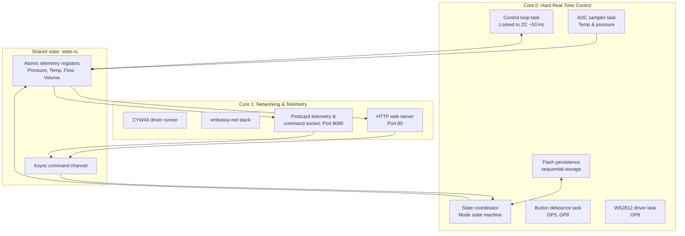

# Firmware design and architecture

## 1. Platform

| Item            | Value                                                            |
| --------------- | ---------------------------------------------------------------- |
| Microcontroller | RP2350B (Pimoroni Pico Plus 2 W)                                 |
| Runtime         | Rust `no_std`, Embassy async framework                           |
| Allocation      | No dynamic heap; static cells and `heapless` only                |
| Default Target  | `thumbv8m.main-none-eabihf` (configured in `.cargo/config.toml`) |

## 2. Core allocation

### Core 0 responsibilities

- **Control loop task (`control.rs`):** Synchronously driven by the AC zero-cross rising edge from PIO0 SM1. Drains FIFO, filters period with EMA, reads current pressure/temperature/flow, updates PID loops, and writes actuator outputs.
- **Flow meter task (`flow_meter.rs`):** Measures half-period pulse intervals from the Digmesa Nano turbine on PIO2 SM0 (49,162 pulses/L, 98,324 edges/L). Calculates instantaneous flow rate and accumulates shot volume in ml.
- **State coordinator (`coordinator.rs`):** Manages transitions across machine states (`Idle`, `Brewing`, `Steaming`, `Sleeping`, `Pumping`, `Cooling`, `HotWater`) and steps through extraction profiles.
- **Button debouncer (`buttons.rs`):** Debounces GP5..GP8 physical inputs.
- **Flash persistence (`settings.rs`, `profiles.rs`):** Sole owner of flash writes using `sequential-storage`.

### Core 1 responsibilities

- **CYW43 runner (`wifi_task.rs`):** Communicates with the onboard Wi-Fi chip over PIO1 SPI.
- **Network stack (`dhcp.rs`):** Manages DHCP client and Access Point fallback.
- **HTTP server (`web_api.rs`):** Serves embedded UI assets and REST API endpoints on port 80.
- **Telemetry socket (`web_api.rs`):** Streams binary postcard frames at 50 Hz and receives JSON commands on port 8080.

## 3. Dual-PID control loop architecture

Core 0 runs two independent PID controllers in `ac_sync_control_task`:

### 3.1 Temperature PID (`temp_pid`)

- **Execution rate:** 5 Hz (evaluated every 10 mains half-cycles at 50 Hz).
- **Output:** Modulates the boiler Solid State Relay (SSR) duty cycle.
- **Dynamic flow feed-forward:** During active brewing (`brew_active = true`), cold water entering the boiler causes temperature sag. The controller offsets the setpoint in real time:
  $$\text{effective\_target\_t} = \text{target\_t} + \min(20.0, \text{flow\_ml\_s} \times \text{feed\_forward})$$
  This preemptively injects heat proportional to incoming flow before the external thermistor registers a drop.

### 3.2 Unified Pressure and Flow PID (`pump_pid`)

- **Execution rate:** 50 Hz (evaluated synchronously on every mains half-cycle).
- **Output:** Phase-angle firing delay for the vibration pump triac.
- **Two-dimensional target normalization:** Profile steps define both target pressure $P_{\text{target}}$ (bar) and target flow rate $Q_{\text{target}}$ (ml/s). Both channels map onto a unified dimensionless axis normalized to 1.0:
  $$u_p = 1.0 + W_p \times \left(\frac{P_{\text{meas}}}{P_{\text{target}}} - 1.0\right)$$
  $$u_q = 1.0 + W_q \times \left(\frac{Q_{\text{meas}}}{Q_{\text{target}}} - 1.0\right)$$
- **Binding constraint arbitration:** The pump PID updates with the larger error:
  $$u_{\text{binding}} = \max(u_p, u_q)$$
  If flow exceeds target (e.g. puck channeling), $u_q \ge u_p$ and flow limits pump power. Once puck resistance builds, pressure rises and $u_p$ governs.

## 4. AC actuator and PIO timing

The vibration pump incorporates an internal diode, energizing on only one half-wave of AC mains (50 Hz or 60 Hz). The control loop locks directly to this frequency.

The zero-cross optocoupler pulls GP10 LOW during the positive half-wave and releases HIGH during the negative half-wave. The falling edge provides the sole precise timing reference.

### State machine allocation (PIO0)

| SM            | Clock  | Counts         | Role                                                                 |
| ------------- | ------ | -------------- | -------------------------------------------------------------------- |
| Trigger (SM1) | 2 MHz  | 1 µs per count | Measures the LOW conduction window and paces the 50 Hz control tick. |
| Triac (SM2)   | 1 MHz  | 1 µs per count | Fires the pump triac gate at a delay offset from the falling edge.   |
| Heater (SM0)  | 16 kHz | 2 ms per loop  | Latches the boiler heater bit clear of the zero crossing.            |

### Firing delay and fail-safe logic

- **Triac delay calculation:** Expressed as a fraction of the measured zero-cross window:
  $$\text{delay} = \text{fraction}(\text{duty}) \times \text{ac\_ema}$$
  The lookup table scales from 0.60 at 0% duty down to 0.20 at 100% duty.
- **Heater hardware fail-safe:** The Heater SM uses `pull noblock`. An empty FIFO reads 0 (heater OFF). If the control task stalls, the heater shuts off automatically in hardware without watchdog intervention.

### Cycle execution timeline

| t (ms) | ZC  | Half-wave | Trigger SM (PIO)                | Control task                                      | Pump triac (random-phase MOC)                      | Heater (zero-cross MOC)                       |
| ------:|:---:|:--------- |:------------------------------- |:------------------------------------------------- |:-------------------------------------------------- |:--------------------------------------------- |
| 0      | ↑   | HIGH      | Rising edge: push count; re-arm | Woken: drain FIFO, compute $D_1, H_1$, push FIFOs | SM parked holding $D_1$                            | —                                             |
| 10     | ↓   | **LOW**   | Falling edge: count 1 µs/tick   | Idle                                              | Edge seen: delay $d(D_1)$, fire gate at $10 + d_1$ | `wait 0` → `nop [31]`                         |
| 20     | ↑   | HIGH      | Push word 2                     | Wake: compute $D_2, H_2$                          | Triac commutates off at current zero               | $H_1$ latched at 12 ms; MOC on for full cycle |
| 30     | ↓   | **LOW**   | Count                           | Idle                                              | Gate at $30 + d_2$                                 | $H_2$ latched at 32 ms                        |
| 40     | ↑   | HIGH      | Push word 3                     | Wake: compute $D_3, H_3$                          | Off                                                | $H_2$ conducts                                |
| 50     | ↓   | **LOW**   | Count                           | Idle                                              | Gate at $50 + d_3$                                 | $H_3$ latched at 52 ms                        |

## 5. Non-volatile flash storage

Oximite persists settings and extraction profiles in the upper sectors of the RP2350 internal flash memory using `sequential-storage` for wear leveling.

| Flash Region       | Size     | Content                                           |
| ------------------ | -------- | ------------------------------------------------- |
| Application binary | ~512 KiB | Executable firmware (`.text`, `.rodata`)          |
| CYW43 Wi-Fi blobs  | ~256 KiB | Wi-Fi 43439A0 firmware and CLM blob               |
| Settings storage   | 16 KiB   | Wi-Fi credentials, PID gains, target temperatures |
| Profiles storage   | 32 KiB   | Up to 10 multi-step extraction profiles           |

### Storage ownership

- Core 0 alone writes to flash via `DMA_CH1`. Core 1 never touches flash hardware.
- Flash writes briefly stall XIP. Time-critical PIO state machines run independently in hardware during writes.

### Schemas

- **Settings:** Wi-Fi credentials (`wifi_ssid`, `wifi_password`), target temperatures (`brew_temp`, `steam_temp`), and PID gains (`temp_pid`, `pump_pid`).
- **Profiles (`BrewProfile`):** Contains `name` (up to 32 bytes) and up to 5 steps (`BrewProfileStep`):
  - `pressure`: `Option<f32>` (target bar)
  - `flow`: `Option<f32>` (target ml/s)
  - `time_s`: `Option<f32>` (duration limit)
  - `volume`: `Option<f32>` (volume limit)

## 6. Inter-core communication

Data crosses between cores strictly through `state.rs`:

- **Lock-free atomics:** Sensor readings, actuator states, and cumulative volume are published as `portable_atomic` types. Core 1 reads them lock-free without delaying Core 0.
- **Command channel:** User actions from HTTP or the telemetry socket are queued via an `embassy_sync::channel::Channel`. Core 0 consumes and executes them in its state coordinator loop.
- **DMA IRQ sharing:** `DMA_CH0` (CYW43 SPI on Core 1) and `DMA_CH1` (Flash on Core 0) bind to `DMA_IRQ_0`.
