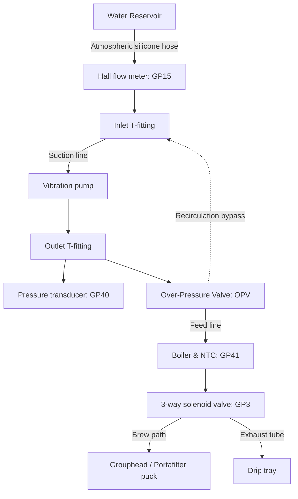

# Mechanics and hydraulic installation

This document describes mounting, enclosure constraints, and hydraulic sensor placement inside domestic espresso machines.

## 1. Electronics mounting and bracket

The controller board mounts inside the chassis using 3D-printable brackets:

- **Material:** PETG, ABS, or ASA. Do NOT use PLA due to elevated temperatures (~60–80 °C) inside the machine casing.
- **Placement:** Position the board in the lower or cooler quadrant of the machine (opposite the boiler exhaust). Ensure air gap from the boiler body.

## 2. Hydraulic sensor integration

### Flow meter placement

- **Inlet only:** The Digmesa Nano DM60 plastic flow meter (49,162 pulses/L) MUST be installed on the low-pressure suction side (between reservoir and pump inlet). Its plastic body cannot withstand pump pressure (up to 15 bar).
- **Air bubbles:** Mount horizontally with nozzle pointing down to prevent trapped air pockets that cause pulse jitter.
- **Recirculation:** The OPV bypass connects back to the pump inlet after the flow meter through an inlet T-fitting. Recirculated water does not affect water volume.

### Pressure transducer placement

- **High-pressure side:** Installed via a metal T-fitting between the pump outlet and the boiler.
- **Thread sealing:** Standard G1/8" thread sealed with food-grade high-temperature thread sealant or bonded copper washer.

## 3. Front panel switch layout

The machine front panel mounts two 3-position momentary mini toggle switches (spring return to center):
- **Left Switch:**
  - **UP (GP5):** Power (wakes machine from sleep or puts it to sleep).
  - **MIDDLE:** Neutral (center-off, open circuit).
  - **DOWN (GP7):** Steam (toggles boiler heating to steam setpoint).
- **Right Switch:**
  - **UP (GP8):** Flush (runs grouphead flush at 80% duty; hold on boot to enter AP mode).
  - **MIDDLE:** Neutral (center-off, open circuit).
  - **DOWN (GP6):** Brew (starts or aborts the active extraction profile).

  
